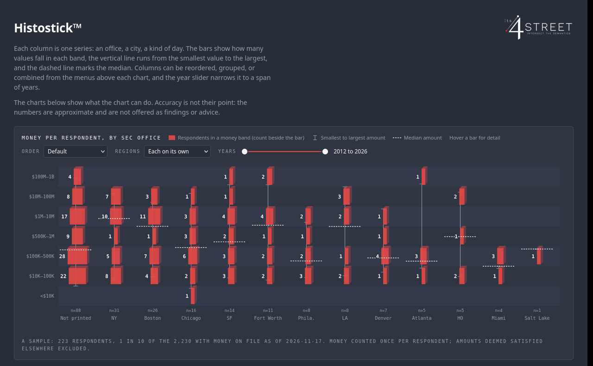

# Histostick™

*A snapshot of the demonstration page, as it looks when you run it.*

A histogram and a candlestick in one mark. One column per series (an office, a city, a kind of day). Inside each column:

- **bars**: one per band present in the data; bar width is how many values fall in that band, with the count beside it
- **wick**: the series' smallest to largest value
- **dashed tick**: the series' median value

Hover or tap a bar for the band's range, count and share; hover the column for the series summary. The x-axis can
be reordered, grouped under brackets, or combined group by group, from the menus above the chart or from code. When
the columns do not fit, the chart scrolls sideways and the band axis stays pinned. When the values carry dates, a
two-handle year slider narrows the chart to a span of years.

Plain JavaScript and SVG: no packages, no install, no build step, nothing loaded from outside this folder.

Offered as open source by [4STREET](https://its4street.com) under the MIT licence, as is.

## See it without installing or running anything

Open `standalone.html` in a browser (double-click it). That one file holds the whole demonstration: the page, the
styles, the chart code, the data and the images. It needs no server, no Node, no packages and no network.

## Run the demo from the source files

    git clone https://github.com/its-4Street/histostick.git
    cd histostick
    node scripts/serve.mjs          # http://127.0.0.1:4173/
    node scripts/verify.mjs         # the numbers, the page, and that the project is self-contained

Any static web server works in place of the first line. Opening `index.html` straight from disk does not, because
browsers will not load modules or data from a double-clicked file.

## Use the chart in your own page

Copy two files, `src/histostick.js` and `src/histostick.css`. They are all the chart needs.

    <link rel="stylesheet" href="histostick.css" />
    

    

**Order** (`sort`): `"given"`, `"count"`, `"median"`, `"total"`, `"label"`, an array of column keys, or a compare
function. **Grouping** (`grouping`, for columns that carry a `group`): `"none"`, `"grouped"` (members sit together
under a bracket, sorted inside the group) or `"combined"` (one column per group, holding every member's values).

Other numbers than money: pass `bands` (`[[lo, hi, label], ...]`), `scale: "linear"`, a `format` function, and the
wording (`unit`, `bandNoun`, `valueNoun`); `showTotal: false` when a sum means nothing; `widthBy: "share"` when
columns differ a lot in size and it is their shapes you want to compare. `controls: false` hides the menus and
`time: false` hides the year slider. Columns size themselves to the element (56 to 96 px each) and redraw on
resize; pass `colWidth` to fix the width. `buildChart(options)` returns the SVG markup and the numbers without a
browser, and `arrange(columns, options)` returns just the ordered, grouped columns.

Colours and fonts are the `--hs-` variables at the top of `src/histostick.css`; set them on `.hs` or on any element
around the chart.

## The demonstration data

The four charts on the page are illustrations of what the chart can do. Accuracy is not their point: the numbers are
approximate, they are not offered as findings, and they are not investment, medical or legal advice.

- **SEC respondents** (`src/sec-data.js`): a 1 in 10 sample of respondents in US Securities and Exchange Commission
  actions with money ordered against them, compiled by 4STREET from public SEC documents. A row is
  `[amount, date, offices]` and nothing else: no names, no case numbers.
- **NVDA daily moves** (`data/nvda-moves.json`): each session's percentage move, 2021 to 2026, worked out from daily
  prices published by Yahoo Finance, with flags for the kind of day. Moves only: prices and volumes are not
  included. Earnings dates are approximate. The slicing rules are in `src/nvda-columns.js`.
- **Blood pressure of US adults** (`data/nhanes-blood-pressure.json`): systolic readings of 21,893 adults examined
  in the CDC's National Health and Nutrition Examination Survey, cycles 2011-2012 to 2017-2018, with age, sex, body
  mass index and family income against the poverty line. No identifiers. Counts of examined people, not national
  estimates: the survey's sampling weights are not applied. `scripts/extract-nhanes.mjs` rebuilds it from the CDC's
  public files (listed at the top of that script).
- **Home prices** (`data/dummy-home-prices.json`): **fictional**. The cities do not exist and every number comes
  from a seeded random generator (`scripts/make-dummy.mjs`). It is flagged as fictional on the page.

## What is in here

    index.html                    the demonstration page
    src/histostick.js             the chart (mountChart, buildChart, arrange, columnStats, yearsOf, withinYears)
    src/histostick.css            the chart's styles
    src/page.js, src/style.css    the demonstration page's wiring and styles
    src/sec-data.js               the SEC sample, one row per line
    src/*-columns.js              each data set turned into chart columns
    data/                         the other data sets
    assets/                       the 4STREET logo, the page icon and the snapshot shown above
    scripts/serve.mjs             a local static server (this machine only)
    scripts/verify.mjs            the checks
    scripts/sync-meta.mjs         copies codemeta.json into the page's structured data block
    scripts/build-standalone.mjs  rebuilds standalone.html from index.html, src/, data/ and assets/
    scripts/make-dummy.mjs        regenerates the fictional set
    scripts/extract-nhanes.mjs    rebuilds the blood pressure set from the CDC's files
    codemeta.json, llms.txt       descriptions for machines and agents

## Safe to download

There is nothing to install and nothing runs on its own. The page loads only files from its own folder, sends
nothing anywhere and stores nothing in the browser. The scripts use Node built-ins only, and the local server
listens on this machine alone. `node scripts/verify.mjs` checks all of that; `SECURITY.md` has the detail and says
how to report a problem.

## Licence, disclaimer and who offers it

The code is under the MIT licence (`LICENSE`), copyright 2026 4STREET. It is provided as is, with no warranty of
any kind, and the authors accept no liability for its use; the licence has the full wording. The licence covers the
code. The demonstration data comes from the public sources named above. Histostick is a trademark of
4STREET. The Histostick and 4STREET names and the logo (`assets/`) are not covered by the licence.

4STREET is designed to bring Market Intelligence, Regulatory Compliance, while ensuring IP & PII is protected under
the most sophisticated Agentic Workflows for Asset Managers and other heavily regulated firms. Histostick grew out of 4STREET's charting of enforcement data.
Site: https://its4street.com. Contact: contact@its4street.com. Source: https://github.com/its-4Street/histostick.

For agents and other machine readers: `codemeta.json` describes the project, its publisher and every bundled data
set as structured data (the same content is embedded in `index.html` as JSON-LD), and `llms.txt` is a plain-text
guide. `node scripts/verify.mjs` checks that the three agree.
